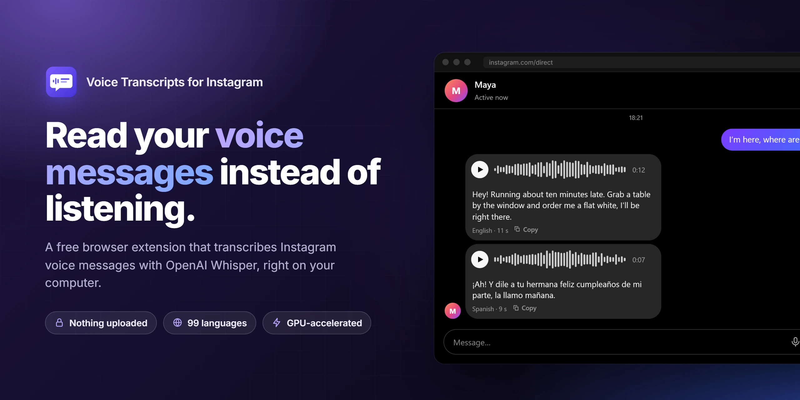
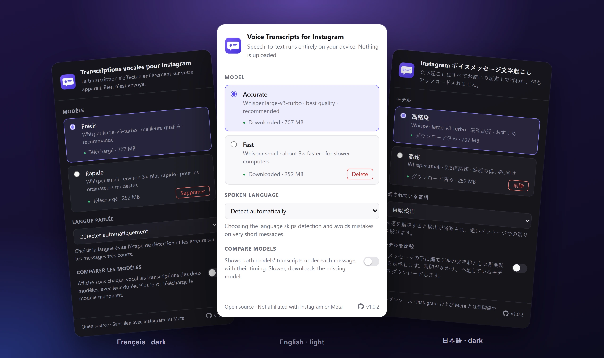
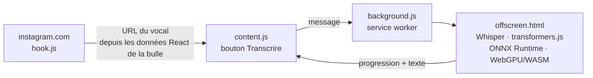

<div align="center">



<h3>Lisez vos messages vocaux Instagram en texte, en toute confidentialité, directement dans votre navigateur.</h3>

<p>
  <a href="https://github.com/Raitofod/voice-transcripts-for-instagram/releases/latest"></a>
  <a href="https://github.com/Raitofod/voice-transcripts-for-instagram/releases"></a>
  <a href="LICENSE"></a>
  
  
</p>

<p>
  <a href="https://github.com/Raitofod/voice-transcripts-for-instagram/releases/latest"></a>
  &nbsp;
  <a href="#-installation-en-2-minutes"></a>
</p>

<p><a href="README.md">English</a> · <b>Français</b> · <a href="https://raitofod.github.io/voice-transcripts-for-instagram/">Site web</a></p>

</div>

---

## ✨ Démonstration

<div align="center">
  
  <br>
  <sub>L'animation est accélérée. Les durées affichées sous chaque transcription sont réalistes. L'interface s'affiche dans la langue de votre navigateur.</sub>
</div>

<br>

Vous êtes en réunion, dans le train ou dans un endroit bruyant, et un ami vous envoie un vocal d'une minute.
Avec cette extension, un bouton **Transcrire** apparaît sous chaque message vocal sur
[instagram.com](https://www.instagram.com/direct/inbox/). Un clic, et le message devient du texte quelques
secondes plus tard, dans sa langue d'origine.

Contrairement à la transcription d'Instagram, qui échoue souvent (*« Unable to transcribe »*) et n'est pas
proposée partout, elle fonctionne pour tous les vocaux, dans 99 langues. **Tout se passe sur votre ordinateur :**
l'audio n'est jamais envoyé à qui que ce soit.

## 🌟 Fonctionnalités

<table>
  <tr>
    <td width="33%" valign="top">
      <br>
      <b>100 % confidentiel</b><br>
      <sub>La transcription tourne sur votre ordinateur avec Whisper d'OpenAI. Ni serveur, ni compte, ni pistage.</sub>
    </td>
    <td width="33%" valign="top">
      <br>
      <b>Très précis</b><br>
      <sub>Utilise Whisper large-v3-turbo, l'un des meilleurs modèles de reconnaissance vocale, même avec un accent ou du bruit de fond.</sub>
    </td>
    <td width="33%" valign="top">
      <br>
      <b>99 langues</b><br>
      <sub>La langue parlée est détectée automatiquement à chaque message. Les conversations multilingues fonctionnent sans réglage.</sub>
    </td>
  </tr>
  <tr>
    <td width="33%" valign="top">
      <br>
      <b>Accéléré par la carte graphique</b><br>
      <sub>Utilise votre carte graphique avec WebGPU quand c'est possible, sinon le processeur.</sub>
    </td>
    <td width="33%" valign="top">
      <br>
      <b>Copie en un clic</b><br>
      <sub>Copiez une transcription pour la coller dans une note, un e-mail ou un traducteur.</sub>
    </td>
    <td width="33%" valign="top">
      <br>
      <b>Vous gardez la main</b><br>
      <sub>Choisissez entre un modèle précis et un modèle rapide, fixez la langue, comparez les deux modèles et libérez de l'espace disque.</sub>
    </td>
  </tr>
</table>

L'interface est disponible en **anglais, français, espagnol, allemand, italien, portugais (Brésil), turc et japonais**. Elle suit la langue de votre navigateur et son thème clair ou sombre.

## 🚀 Installation en 2 minutes


L'extension n'est pas encore sur le Chrome Web Store : elle s'installe depuis cette page. Elle fonctionne dans
**Chrome, Edge, Brave, Opera, Vivaldi, Arc** et les autres navigateurs basés sur Chromium (version 116 ou
plus récente), sous Windows, macOS et Linux.

1. **Téléchargez** `voice-transcripts-x.y.z.zip` depuis la [dernière version](https://github.com/Raitofod/voice-transcripts-for-instagram/releases/latest).
2. **Décompressez-le** dans un dossier que vous garderez, par exemple `Documents/Voice Transcripts`. Ne supprimez pas ce dossier : le navigateur charge l'extension depuis celui-ci.
3. Ouvrez la page des extensions en tapant `chrome://extensions` dans la barre d'adresse (`edge://extensions` dans Edge, `brave://extensions` dans Brave).
4. Activez le **Mode développeur**, en haut à droite (dans la barre latérale gauche sous Edge).
5. Cliquez sur **Charger l'extension non empaquetée** et choisissez le dossier de l'étape 2.
6. *(Facultatif)* Cliquez sur l'icône puzzle 🧩 de la barre d'outils et épinglez **Transcriptions vocales pour Instagram** pour accéder aux réglages en un clic.

Ouvrez ensuite une conversation sur [instagram.com](https://www.instagram.com/direct/inbox/) et cliquez sur **Transcrire** sous un vocal.

> [!NOTE]
> **La première transcription prend quelques minutes.** Le modèle de reconnaissance vocale (environ 700 Mo) est téléchargé une seule fois depuis Hugging Face et conservé par votre navigateur. Ensuite, les transcriptions démarrent immédiatement et fonctionnent hors ligne.

<details>
<summary><b>Mettre à jour vers une nouvelle version</b></summary>
<br>

1. Téléchargez le nouveau zip depuis la [dernière version](https://github.com/Raitofod/voice-transcripts-for-instagram/releases/latest).
2. Décompressez-le **dans le même dossier qu'avant**, en remplaçant les anciens fichiers.
3. Ouvrez `chrome://extensions`, cliquez sur l'icône ↻ de la carte de l'extension, puis rechargez votre onglet Instagram.

Garder le même dossier conserve vos réglages et le modèle téléchargé. Un autre dossier est considéré comme une nouvelle extension et retélécharge le modèle.

</details>

<details>
<summary><b>Désinstaller</b></summary>
<br>

Ouvrez `chrome://extensions` et cliquez sur **Supprimer** sur la carte de l'extension. Le navigateur efface l'extension, ses réglages et les modèles téléchargés. Vous pouvez ensuite supprimer le dossier.

</details>

## ⚙️ Réglages



Cliquez sur l'icône de l'extension dans la barre d'outils pour ouvrir les réglages.

| Réglage | Rôle |
| --- | --- |
| **Modèle** | **Précis** (Whisper large-v3-turbo, 700 Mo) donne les meilleurs résultats ; c'est le choix par défaut. **Rapide** (Whisper small, 250 Mo) est plus léger, pour les ordinateurs anciens. Chaque carte indique si le modèle est téléchargé et la place qu'il occupe. Vous pouvez supprimer celui qui ne sert pas. |
| **Langue parlée** | **Détecter automatiquement** convient à tout le monde. Si vos contacts parlent toujours la même langue, la choisir saute l'étape de détection et évite les erreurs sur les messages très courts. |
| **Comparer les modèles** | Transcrit chaque vocal avec les deux modèles, côte à côte, avec leur durée. Pratique pour choisir le modèle adapté à votre ordinateur. |

## 🔒 Confidentialité


**Vos messages vocaux ne quittent jamais votre ordinateur.** L'extension télécharge seulement deux choses et n'envoie jamais rien :

- le vocal sur lequel vous avez cliqué, depuis les serveurs média d'Instagram (le même fichier que votre navigateur lit quand vous appuyez sur ▶) ;
- le modèle Whisper open source, depuis Hugging Face, la première fois que vous l'utilisez.

L'audio est décodé en mémoire puis effacé après la transcription. Les transcriptions s'affichent dans la page et ne sont enregistrées nulle part : elles disparaissent quand vous rechargez la page. Seuls vos trois réglages et les fichiers du modèle sont conservés. Il n'y a ni statistiques, ni publicité, ni serveur géré par l'auteur. Le code est ouvert : tout est vérifiable dans le dossier [`extension/`](extension).

Lire la [politique de confidentialité](PRIVACY.md) complète (en anglais).

## ⚡ Performances

Mesurées sur un portable de milieu de gamme (processeur Intel avec puce graphique Iris Xe), le modèle *Précis* déjà chargé et la langue détectée automatiquement :

| Vocal | Temps de transcription |
| :---: | :--------------------: |
| 5 s   | 9 s                    |
| 7 s   | 11 s                   |
| 20 s  | 14 s                   |
| 75 s  | 97 s                   |

- **La carte graphique fait le gros du travail.** L'encodeur de Whisper tourne sur le GPU via WebGPU. Sur ce portable, un vocal de 7 s prend ainsi 9 s, contre 30 s avec le processeur seul.
- **Un message court coûte presque autant qu'un message de 30 secondes.** Whisper travaille toujours par fenêtres de 30 secondes. Les messages plus longs sont découpés en fenêtres qui se chevauchent.
- **Sur un ordinateur ancien**, choisissez le modèle *Rapide* (environ 6 s pour un vocal de 7 s sur le même portable). Vous pouvez aussi fixer la langue parlée pour sauter la détection.
- Si vous cliquez sur plusieurs vocaux, ils sont transcrits l'un après l'autre. Chacun indique combien passent avant lui, puis un compteur du temps écoulé.

## ❓ Questions fréquentes

<details>
<summary><b>C'est vraiment gratuit ?</b></summary>
<br>
Oui. C'est un logiciel open source sous licence MIT. Il n'y a ni offre payante, ni publicité, ni compte. La transcription tourne sur votre ordinateur, elle ne coûte donc rien à faire fonctionner.
</details>

<details>
<summary><b>Est-ce que ça marche sur téléphone ou dans l'application Instagram ?</b></summary>
<br>
Non. C'est une extension de navigateur pour ordinateur. Elle fonctionne sur le site instagram.com dans Chrome, Edge, Brave, Opera, Vivaldi, Arc et les autres navigateurs basés sur Chromium. Firefox et Safari ne sont pas pris en charge.
</details>

<details>
<summary><b>Instagram peut-il voir que je l'utilise ? Mon compte risque-t-il quelque chose ?</b></summary>
<br>
L'extension ne publie, n'aime, n'envoie et n'automatise rien, et elle ne fait aucune requête supplémentaire aux serveurs d'Instagram. Elle lit la conversation déjà ouverte dans votre navigateur et télécharge le fichier du vocal, exactement comme le lecteur quand vous appuyez sur ▶. Cela dit, c'est un outil non officiel, sans lien avec Instagram ou Meta.
</details>

<details>
<summary><b>Pourquoi la première transcription est-elle si lente ?</b></summary>
<br>
La première fois, le navigateur télécharge le modèle (environ 700 Mo pour <i>Précis</i>, 250 Mo pour <i>Rapide</i>) et le prépare. La barre de progression indique l'avancement du téléchargement. Ensuite, le modèle est conservé et se charge en quelques secondes.
</details>

<details>
<summary><b>Quelle place sur le disque ?</b></summary>
<br>
Environ 700 Mo avec le modèle <i>Précis</i>, ou 250 Mo avec le modèle <i>Rapide</i>. Le panneau de réglages affiche la taille exacte et permet de supprimer un modèle inutilisé.
</details>

<details>
<summary><b>La transcription contient des erreurs. Que faire ?</b></summary>
<br>
Vérifiez que le modèle <i>Précis</i> est sélectionné. Si la langue a été mal détectée, ce qui peut arriver sur des messages de quelques mots, fixez la langue parlée dans les réglages. Un fort bruit de fond, de la musique ou plusieurs personnes qui parlent en même temps rendent aussi la reconnaissance plus difficile.
</details>

<details>
<summary><b>Pourquoi n'est-elle pas sur le Chrome Web Store ?</b></summary>
<br>
Elle pourrait y arriver plus tard. En attendant, l'installation depuis GitHub prend deux minutes et vous donne exactement le code que vous pouvez lire dans ce dépôt.
</details>

<details>
<summary><b>Le bouton Transcrire n'apparaît pas.</b></summary>
<br>
Rechargez l'onglet Instagram après avoir installé ou mis à jour l'extension. Vérifiez qu'elle est activée dans <code>chrome://extensions</code>. Instagram modifie souvent son site : si le bouton n'apparaît toujours pas, <a href="https://github.com/Raitofod/voice-transcripts-for-instagram/issues/new/choose">signalez-le</a>.
</details>

<details>
<summary><b>Quelles langues sont prises en charge ?</b></summary>
<br>
Afrikaans, albanais, allemand, amharique, anglais, arabe, arménien, assamais, azerbaïdjanais, bachkir, basque, bengali, biélorusse, birman, bosniaque, breton, bulgare, cantonais*, catalan, chinois, cingalais, coréen, créole haïtien, croate, danois, espagnol, estonien, féroïen, filipino, finnois, français, galicien, gallois, géorgien, goudjarati, grec, haoussa, hawaïen, hébreu, hindi, hongrois, indonésien, islandais, italien, japonais, javanais, kannada, kazakh, khmer, lao, latin, letton, lingala, lituanien, luxembourgeois, macédonien, malais, malayalam, malgache, maltais, maori, marathi, mongol, néerlandais, népalais, norvégien, norvégien nynorsk, occitan, ourdou, ouzbek, pachto, pendjabi, persan, polonais, portugais, roumain, russe, sanskrit, serbe, shona, sindhi, slovaque, slovène, somali, soundanais, suédois, swahili, tadjik, tamoul, tatar, tchèque, télougou, thaï, tibétain, turc, turkmène, ukrainien, vietnamien, yiddish et yoruba.
<br><br>
<sub>* Le cantonais est pris en charge par le modèle <i>Précis</i> uniquement.</sub>
<br><br>
La précision varie selon la langue. Elle est excellente pour les langues très parlées comme le français, l'anglais, l'espagnol, l'allemand, le portugais, l'italien, le japonais et le chinois.
</details>

## 🛠️ Fonctionnement

<details>
<summary><b>Architecture, pour les développeurs</b></summary>
<br>



- **`hook.js`** s'exécute dans la page. Au clic sur **Transcrire**, il lit l'URL audio du vocal dans les données qu'Instagram utilise déjà pour afficher la bulle, y compris pour les messages reçus en direct. En secours, il lit aussi les réponses de l'API qu'Instagram télécharge déjà. Il ne fait aucune requête de lui-même.
- **`content.js`** ajoute le bouton, la barre de progression, la transcription et le bouton Copier sous chaque vocal. Il les conserve quand Instagram réaffiche la conversation.
- **`background.js`** transmet les demandes à un document offscreen unique, qui traite une transcription à la fois.
- **`offscreen.js`** télécharge l'audio depuis le CDN d'Instagram et le décode à 16 kHz. Il détecte la langue avec une étape du décodeur de Whisper, puis transcrit par fenêtres de 30 secondes avec [transformers.js](https://github.com/huggingface/transformers.js) et [ONNX Runtime Web](https://onnxruntime.ai/). Avec WebGPU, l'encodeur du modèle *Précis* tourne sur le GPU (`q4f16`) et le décodeur sur le processeur (`q4`) : c'est la configuration la plus rapide lors de nos tests.

L'extension est écrite en JavaScript simple (Manifest V3), sans bundler ni framework.

</details>

## 🤝 Contribuer

Les signalements de bugs, corrections et traductions sont les bienvenus. Ajouter une langue à l'interface ne demande qu'un fichier JSON : voir [CONTRIBUTING.md](CONTRIBUTING.md) (en anglais).

```sh
git clone https://github.com/Raitofod/voice-transcripts-for-instagram.git
# puis chargez le dossier extension/ avec « Charger l'extension non empaquetée ». Aucune compilation.

npm install      # seulement pour mettre à jour le runtime embarqué
npm run vendor   # copie transformers.js et ONNX Runtime dans extension/vendor
npm run zip      # crée dist/voice-transcripts-<version>.zip
```

Pousser un tag comme `v1.0.3` (identique à `manifest.json`) publie le zip dans une release GitHub. Voir le [journal des modifications](CHANGELOG.md).

Si l'extension vous est utile, une ⭐ sur ce dépôt aide d'autres personnes à la découvrir.

## 📜 Crédits et licence

- [OpenAI Whisper](https://github.com/openai/whisper) (MIT), exports ONNX par [onnx-community](https://huggingface.co/onnx-community)
- [transformers.js](https://github.com/huggingface/transformers.js) (Apache-2.0) et [ONNX Runtime Web](https://github.com/microsoft/onnxruntime) (MIT), embarqués dans `extension/vendor/` (voir [THIRD_PARTY_NOTICES.md](THIRD_PARTY_NOTICES.md))

Publié sous [licence MIT](LICENSE).

<sub>Ce projet n'est ni affilié à Instagram ou Meta Platforms, Inc., ni approuvé ou sponsorisé par eux. Instagram est une marque de Meta Platforms, Inc.</sub>
