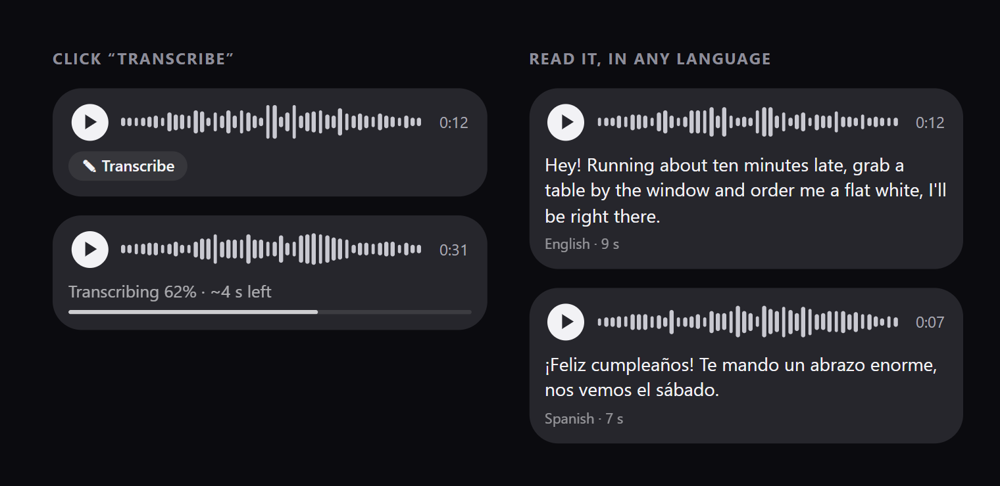
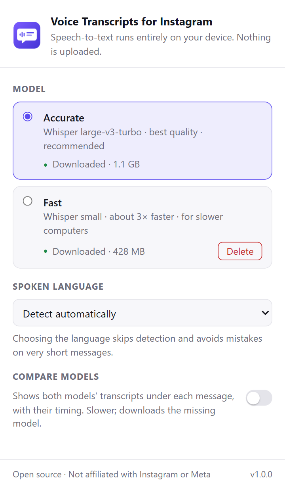
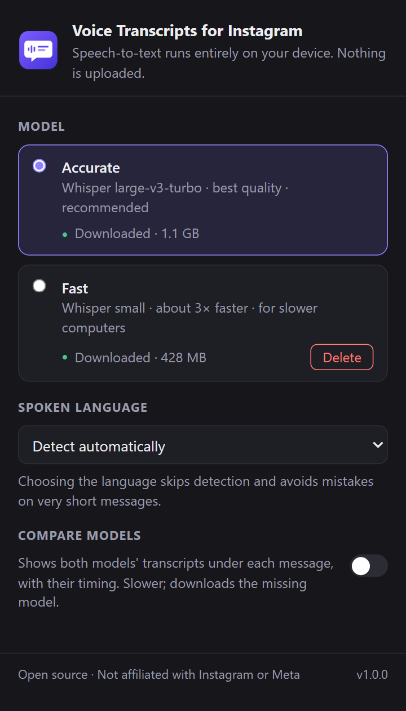
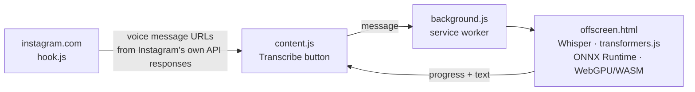

<p align="center">
  
</p>

<h1 align="center">Voice Transcripts for Instagram</h1>

<p align="center">
  Read Instagram voice messages as text, in 99 languages.<br>
  Transcription runs <b>entirely in your browser</b> with OpenAI Whisper. No audio is ever uploaded.
</p>

<p align="center">
  <a href="LICENSE"></a>
  
  
  
</p>

<p align="center">
  
</p>

<p align="center"><a href="README.fr.md">Lire en français</a></p>

---

## Why

Instagram's built-in transcription often fails with *"Unable to transcribe, try again"*, and it is not
offered in every language or region. This extension adds its own **Transcribe** button under every voice
message on [instagram.com](https://www.instagram.com/direct/inbox/). The transcription is computed on your
own computer.

## Features

- **Private by design.** The audio is decoded and transcribed locally with WebAssembly and WebGPU. There is no server, account, API key or tracking.
- **High accuracy.** The extension uses Whisper large-v3-turbo by default. A lighter Whisper small model is available for slower computers.
- **99 spoken languages.** The language is detected automatically for each message. You can also set one language to save a step.
- **Live progress.** A progress bar shows how far the transcription has got, with the elapsed time.
- **Model manager.** You pick the model, see how much disk space each one uses, and delete the model you don't use.
- **Compare mode.** Both models transcribe the same message side by side, with their timings.
- **Localized interface.** English, Français, Español, Deutsch, Italiano, Português (Brasil), Türkçe and 日本語.

## Install

### From a release (recommended)

1. Download `voice-transcripts-x.y.z.zip` from the [latest release](../../releases/latest) and unzip it.
2. Open `chrome://extensions` (or `edge://extensions`, `brave://extensions`…) and turn on **Developer mode**.
3. Click **Load unpacked** and select the unzipped folder.

### From source

```sh
git clone https://github.com/Raitofod/voice-transcripts-for-instagram.git
```

Then load the `extension/` folder with **Load unpacked**. No build step is needed.

## Usage

1. Open a conversation on instagram.com.
2. Click **Transcribe** under a voice message.
3. The first time you transcribe, the model is downloaded once from Hugging Face (about 700 MB for *Accurate*, 250 MB for *Fast*). After that, transcription works offline.

Click the extension icon to change the model or the spoken language, to turn on compare mode, or to free disk space.

<p align="center">
  
  &nbsp;&nbsp;
  
</p>

## Performance

These timings were measured on a laptop with an Intel Iris Xe iGPU, after the model was loaded. The language was detected automatically.

| Voice message | Accurate (large-v3-turbo) |
| ------------- | ------------------------- |
| 5 s           | 9 s                       |
| 7 s           | 11 s                      |
| 20 s          | 14 s                      |
| 75 s          | 97 s                      |

On the same machine, the *Fast* model takes about 6 s for a 7-second message.

Whisper always processes audio in 30-second windows. Short messages therefore cost about as much as 30-second ones. Longer messages are cut into overlapping windows, so the time grows with length. Transcriptions run one at a time; the others show how many are ahead of them.

When WebGPU is available, the *Accurate* model runs its encoder on the GPU. In our tests this halves the time compared with running everything on the CPU. Without WebGPU, the extension falls back to the CPU automatically.

## How it works



- **`hook.js`** runs in the page. When you click **Transcribe**, it reads the voice message's audio URL from the data Instagram already uses to display the bubble, including messages received live. As a fallback, it also reads the API responses that Instagram already downloads. It makes no extra requests to Instagram.
- **`content.js`** adds the button, the progress bar and the transcript under each voice message.
- **`offscreen.js`** downloads the audio from Instagram's CDN and decodes it at 16 kHz. It detects the language and runs Whisper through [transformers.js](https://github.com/huggingface/transformers.js) and [ONNX Runtime Web](https://onnxruntime.ai/). Models are cached by the browser in the extension's own storage.

## Privacy

- Audio and transcripts never leave your device, and transcripts are not stored.
- Network access is limited to Instagram's media CDNs (to read the voice message) and Hugging Face (to download the model once).
- The only data saved is your settings (model, language, compare mode), stored in `chrome.storage.local`.

See [PRIVACY.md](PRIVACY.md) for the full policy.

## Limitations

- The extension works on the instagram.com website only, not in the mobile apps.
- Instagram's web markup changes often. If the button disappears, please [open an issue](../../issues).

## Development

```sh
npm install        # only needed to upgrade the vendored runtime
npm run vendor     # copy transformers.js + ONNX Runtime files into extension/vendor
npm run zip        # build dist/voice-transcripts-<version>.zip
```

The extension is plain JavaScript, with no bundler and no framework. Pushing a tag such as `v1.0.1` (matching `manifest.json`) runs a GitHub Action that publishes the zip as a release.

Want to add a language? See [CONTRIBUTING.md](CONTRIBUTING.md).

## Credits & license

- [OpenAI Whisper](https://github.com/openai/whisper) (MIT), ONNX exports by [onnx-community](https://huggingface.co/onnx-community)
- [transformers.js](https://github.com/huggingface/transformers.js) (Apache-2.0) and [ONNX Runtime Web](https://github.com/microsoft/onnxruntime) (MIT), vendored in `extension/vendor/` (see [THIRD_PARTY_NOTICES.md](THIRD_PARTY_NOTICES.md))

This extension is released under the [MIT license](LICENSE).

> This project is not affiliated with, endorsed by or sponsored by Instagram or Meta Platforms, Inc.
> Instagram is a trademark of Meta Platforms, Inc.
