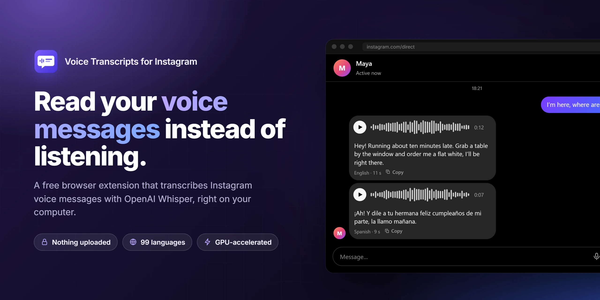
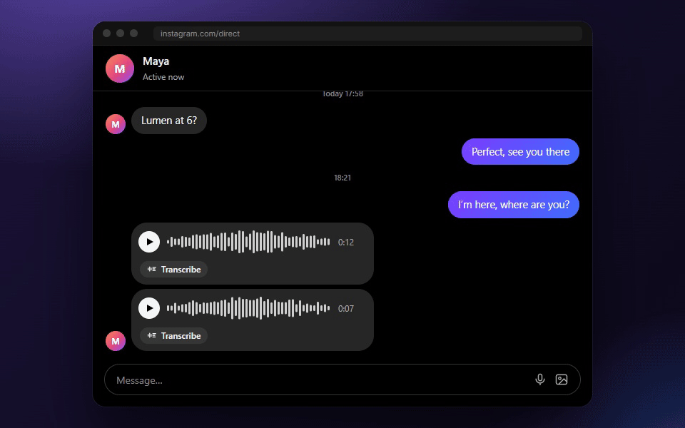
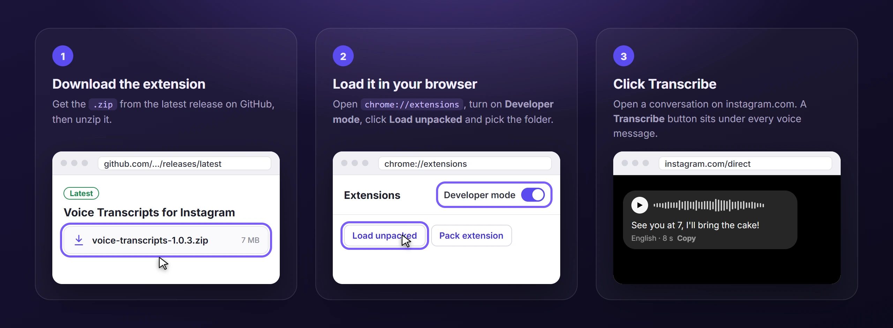
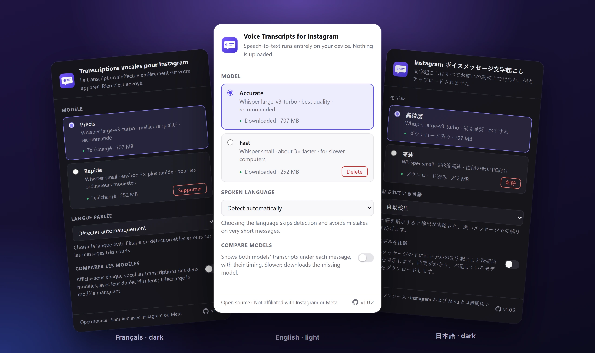
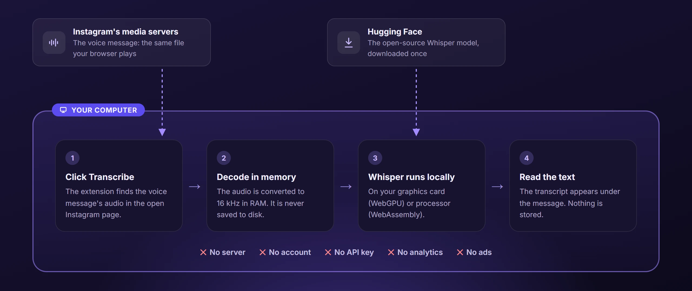
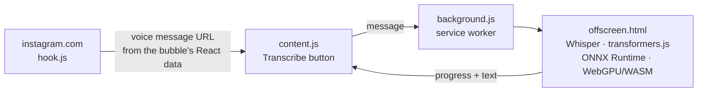

<div align="center">



<h3>Read Instagram voice messages as text, privately, right in your browser.</h3>

<p>
  <a href="https://github.com/Raitofod/voice-transcripts-for-instagram/releases/latest"></a>
  <a href="https://github.com/Raitofod/voice-transcripts-for-instagram/releases"></a>
  <a href="LICENSE"></a>
  
  
</p>

<p>
  <a href="https://github.com/Raitofod/voice-transcripts-for-instagram/releases/latest"></a>
  &nbsp;
  <a href="#-install-in-2-minutes"></a>
</p>

<p><b>English</b> · <a href="README.fr.md">Français</a> · <a href="https://raitofod.github.io/voice-transcripts-for-instagram/">Website</a></p>

</div>

---

## ✨ See it in action

<div align="center">
  
  <br>
  <sub>The animation is sped up. The times shown under each transcript are realistic.</sub>
</div>

<br>

You're in a meeting, on the train or somewhere loud, and a friend sends a one-minute voice message.
With this extension, a **Transcribe** button appears under every voice message on
[instagram.com](https://www.instagram.com/direct/inbox/). Click it, and the message turns into text a few
seconds later, in its original language.

Unlike Instagram's own transcription, which often fails with *"Unable to transcribe"* and is not offered
everywhere, it works for every voice message, in 99 languages. **Everything happens on your computer:** the
audio is never sent to anyone.

## 🌟 Features

<table>
  <tr>
    <td width="33%" valign="top">
      <br>
      <b>100% private</b><br>
      <sub>Transcription runs on your own computer with OpenAI's Whisper. No server, no account, no tracking.</sub>
    </td>
    <td width="33%" valign="top">
      <br>
      <b>Highly accurate</b><br>
      <sub>Uses Whisper large-v3-turbo, one of the best speech recognition models available, even with accents and background noise.</sub>
    </td>
    <td width="33%" valign="top">
      <br>
      <b>99 languages</b><br>
      <sub>The spoken language is detected automatically for every message. Mixed-language chats just work.</sub>
    </td>
  </tr>
  <tr>
    <td width="33%" valign="top">
      <br>
      <b>GPU-accelerated</b><br>
      <sub>Runs on your graphics card with WebGPU when available, and falls back to the processor otherwise.</sub>
    </td>
    <td width="33%" valign="top">
      <br>
      <b>Copy in one click</b><br>
      <sub>Copy any transcript to paste it into a note, an email or a translator.</sub>
    </td>
    <td width="33%" valign="top">
      <br>
      <b>You stay in control</b><br>
      <sub>Choose between an accurate and a fast model, set the language, compare both models, and free disk space.</sub>
    </td>
  </tr>
</table>

The interface is available in **English, Français, Español, Deutsch, Italiano, Português (Brasil), Türkçe and 日本語**. It follows your browser's language and its light or dark theme.

## 🚀 Install in 2 minutes



The extension is not on the Chrome Web Store yet, so you install it from this page. It works in **Chrome, Edge,
Brave, Opera, Vivaldi, Arc** and other Chromium-based browsers (version 116 or later), on Windows, macOS and Linux.

1. **Download** `voice-transcripts-x.y.z.zip` from the [latest release](https://github.com/Raitofod/voice-transcripts-for-instagram/releases/latest).
2. **Unzip it** into a folder you will keep, for example `Documents/Voice Transcripts`. Don't delete this folder: the browser loads the extension from it.
3. Open the extensions page by typing `chrome://extensions` in the address bar (`edge://extensions` in Edge, `brave://extensions` in Brave).
4. Turn on **Developer mode**, in the top-right corner (in the left sidebar in Edge).
5. Click **Load unpacked** and select the folder from step 2.
6. *(Optional)* Click the puzzle icon 🧩 in the toolbar and pin **Voice Transcripts for Instagram**, to reach the settings in one click.

Then open a conversation on [instagram.com](https://www.instagram.com/direct/inbox/) and click **Transcribe** under a voice message.

> [!NOTE]
> **The first transcription takes a few minutes.** The speech recognition model (about 700 MB) is downloaded once from Hugging Face and stored by your browser. After that, transcriptions start right away and work offline.

<details>
<summary><b>How to update to a new version</b></summary>
<br>

1. Download the new zip from the [latest release](https://github.com/Raitofod/voice-transcripts-for-instagram/releases/latest).
2. Unzip it **into the same folder as before**, replacing the old files.
3. Open `chrome://extensions` and click the reload icon ↻ on the extension's card, then reload your Instagram tab.

Using the same folder keeps your settings and the downloaded model. A different folder counts as a new extension and downloads the model again.

</details>

<details>
<summary><b>How to uninstall</b></summary>
<br>

Open `chrome://extensions` and click **Remove** on the extension's card. The browser deletes the extension, its settings and the downloaded models. You can then delete the folder.

</details>

## ⚙️ Settings



Click the extension's icon in the toolbar to open the settings.

| Setting | What it does |
| --- | --- |
| **Model** | **Accurate** (Whisper large-v3-turbo, 700 MB) gives the best results and is the default. **Fast** (Whisper small, 250 MB) is lighter, for older computers. Each card shows whether the model is downloaded and how much space it takes. You can delete the model you don't use. |
| **Spoken language** | **Detect automatically** works for everyone. If your contacts always speak the same language, choosing it skips the detection step and avoids mistakes on very short messages. |
| **Compare models** | Transcribes each message with both models, side by side, with their timings. This is useful for choosing the model that suits your computer. |

## 🔒 Privacy



**Your voice messages never leave your computer.** The extension only downloads two things, and never sends anything:

- the voice message you clicked, from Instagram's own media servers (the same file your browser plays when you press ▶);
- the open-source Whisper model, from Hugging Face, the first time you use it.

The audio is decoded in memory and discarded after transcription. Transcripts are shown in the page and are not saved anywhere: they disappear when you reload the page. The only things stored are your three settings and the model files. There are no analytics, no ads and no servers run by the author. The code is open: you can check everything in the [`extension/`](extension) folder.

Read the full [privacy policy](PRIVACY.md).

## ⚡ Performance

Measured on a mid-range laptop (Intel Core with Iris Xe integrated graphics), with the *Accurate* model already loaded and the language detected automatically:

| Voice message | Time to transcribe |
| :-----------: | :----------------: |
| 5 s           | 9 s                |
| 7 s           | 11 s               |
| 20 s          | 14 s               |
| 75 s          | 97 s               |

- **The graphics card does the heavy lifting.** Whisper's encoder runs on the GPU through WebGPU. On the laptop above, a 7-second message takes 9 s this way, against 30 s on the processor alone.
- **Short messages cost about as much as 30-second ones.** Whisper always works on 30-second windows. Longer messages are cut into overlapping windows.
- **On an older computer**, pick the *Fast* model (about 6 s for a 7-second message on the same laptop). You can also set the spoken language to skip the detection step.
- When you click several messages, they are transcribed one after the other. Each one shows how many are ahead of it, then an elapsed-time counter.

## ❓ FAQ

<details>
<summary><b>Is it really free?</b></summary>
<br>
Yes, and it will stay that way. The source code is open, there is no paid plan, no ads and no account, and the GPL-3.0 license requires every copy and every modified version to stay open source, so no one can turn it into a closed product. The transcription runs on your computer, so it costs nothing to run.
</details>

<details>
<summary><b>Does it work on my phone or in the Instagram app?</b></summary>
<br>
No. It's a browser extension for computers. It works on the instagram.com website in Chrome, Edge, Brave, Opera, Vivaldi, Arc and other Chromium-based browsers. Firefox and Safari are not supported.
</details>

<details>
<summary><b>Can Instagram see that I use it? Is my account at risk?</b></summary>
<br>
The extension doesn't post, like, send or automate anything, and it doesn't make extra requests to Instagram's servers. It reads the conversation that is already open in your browser and downloads the voice message file, exactly as the player does when you press ▶. That said, this is an unofficial tool, not affiliated with Instagram or Meta.
</details>

<details>
<summary><b>Why is the first transcription so slow?</b></summary>
<br>
The first time, the browser downloads the model (about 700 MB for <i>Accurate</i>, 250 MB for <i>Fast</i>) and prepares it. The progress bar shows the download. After that, the model is stored and loads in a few seconds.
</details>

<details>
<summary><b>How much disk space does it use?</b></summary>
<br>
About 700 MB with the <i>Accurate</i> model, or 250 MB with the <i>Fast</i> model. The settings panel shows the exact size and lets you delete a model you don't use.
</details>

<details>
<summary><b>The transcript has mistakes. What can I do?</b></summary>
<br>
Make sure the <i>Accurate</i> model is selected. If the language was detected wrong, which can happen on messages of a few words, set the spoken language in the settings. Strong background noise, music or several people talking at once also make recognition harder.
</details>

<details>
<summary><b>Why is it not on the Chrome Web Store?</b></summary>
<br>
It may come later. Until then, installing from GitHub takes two minutes and gives you exactly the code you can read in this repository.
</details>

<details>
<summary><b>The Transcribe button doesn't appear.</b></summary>
<br>
Reload the Instagram tab after installing or updating the extension. Check that the extension is turned on in <code>chrome://extensions</code>. Instagram changes its website often. If the button still doesn't appear, please <a href="https://github.com/Raitofod/voice-transcripts-for-instagram/issues/new/choose">open an issue</a>.
</details>

<details>
<summary><b>Which languages are supported?</b></summary>
<br>
Afrikaans, Albanian, Amharic, Arabic, Armenian, Assamese, Azerbaijani, Bangla, Bashkir, Basque, Belarusian, Bosnian, Breton, Bulgarian, Burmese, Cantonese*, Catalan, Chinese, Croatian, Czech, Danish, Dutch, English, Estonian, Faroese, Filipino, Finnish, French, Galician, Georgian, German, Greek, Gujarati, Haitian Creole, Hausa, Hawaiian, Hebrew, Hindi, Hungarian, Icelandic, Indonesian, Italian, Japanese, Javanese, Kannada, Kazakh, Khmer, Korean, Lao, Latin, Latvian, Lingala, Lithuanian, Luxembourgish, Macedonian, Malagasy, Malay, Malayalam, Maltese, Māori, Marathi, Mongolian, Nepali, Norwegian, Norwegian Nynorsk, Occitan, Pashto, Persian, Polish, Portuguese, Punjabi, Romanian, Russian, Sanskrit, Serbian, Shona, Sindhi, Sinhala, Slovak, Slovenian, Somali, Spanish, Sundanese, Swahili, Swedish, Tajik, Tamil, Tatar, Telugu, Thai, Tibetan, Turkish, Turkmen, Ukrainian, Urdu, Uzbek, Vietnamese, Welsh, Yiddish and Yoruba.
<br><br>
<sub>* Cantonese is supported by the <i>Accurate</i> model only.</sub>
<br><br>
Accuracy varies by language. It is excellent for widely spoken languages such as English, Spanish, French, German, Portuguese, Italian, Japanese and Chinese.
</details>

## 🛠️ How it works

<details>
<summary><b>Architecture, for developers</b></summary>
<br>



- **`hook.js`** runs in the page. When you click **Transcribe**, it reads the voice message's audio URL from the data Instagram already uses to display the bubble, including messages received live. As a fallback, it also reads the API responses that Instagram already downloads. It makes no requests of its own.
- **`content.js`** adds the button, the progress bar, the transcript and the Copy button under each voice message. It keeps them when Instagram re-renders the conversation.
- **`background.js`** routes requests to a single offscreen document, which runs one transcription at a time.
- **`offscreen.js`** downloads the audio from Instagram's CDN and decodes it at 16 kHz. It detects the language with one Whisper decoder step, then transcribes in 30-second windows with [transformers.js](https://github.com/huggingface/transformers.js) and [ONNX Runtime Web](https://onnxruntime.ai/). With WebGPU, the encoder of the *Accurate* model runs on the GPU (`q4f16`) and the decoder on the CPU (`q4`). This was the fastest setup in our tests.

The extension is plain JavaScript (Manifest V3), with no bundler and no framework.

</details>

## 🤝 Contributing

Bug reports, fixes and translations are welcome. Adding a language to the interface only takes one JSON file: see [CONTRIBUTING.md](CONTRIBUTING.md).

```sh
git clone https://github.com/Raitofod/voice-transcripts-for-instagram.git
# then load the extension/ folder with "Load unpacked". No build step needed.

npm install      # only to upgrade the vendored runtime
npm run vendor   # copy transformers.js and ONNX Runtime into extension/vendor
npm run zip      # build dist/voice-transcripts-<version>.zip
```

Pushing a tag such as `v1.0.3` (matching `manifest.json`) publishes the zip as a GitHub release. See the [changelog](CHANGELOG.md) for what's new.

If you find the extension useful, a ⭐ on this repository helps other people find it.

## 📜 Credits & license

- [OpenAI Whisper](https://github.com/openai/whisper) (MIT), ONNX exports by [onnx-community](https://huggingface.co/onnx-community)
- [transformers.js](https://github.com/huggingface/transformers.js) (Apache-2.0) and [ONNX Runtime Web](https://github.com/microsoft/onnxruntime) (MIT), vendored in `extension/vendor/` (see [THIRD_PARTY_NOTICES.md](THIRD_PARTY_NOTICES.md))

Released under the [GNU General Public License v3.0](LICENSE): you are free to use, study, modify and share the code, as long as anything you distribute based on it stays open source under the same license. If someone asks you to pay for this extension, it's not from here.

<sub>This project is not affiliated with, endorsed by or sponsored by Instagram or Meta Platforms, Inc. Instagram is a trademark of Meta Platforms, Inc.</sub>
